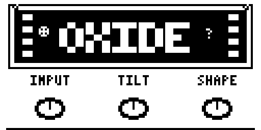

# Oxide

## Overview

Airwindows ToTape9: tape saturation with Dolby-style tilt, bias, flutter and head bump.

## Controls

| Control | Default | Function |
| --- | ---: | --- |
| Input | 50 | Input drive: 50 = unity, 100 = 4x into tape. Above unity, automatic compensation reduces level lift; Output independently trims the wet signal. Range 0–100. |
| Tilt | 50 | Dolby-style encode/decode balance: sets pre-emphasis against de-emphasis, which drives both tape drive and the wet/dry blend. Range 0–100. |
| Shape | 50 | Weights how much of Tilt's encode vs decode lands (0.35..1.0 each way). Subtle by construction, and it was invisible while the x7.14 scaling pinned it. Range 0–100. |
| Flutr | 30 | Airwindows D. Flutter depth in samples at 44.1 kHz. Range 0–100. |
| FlSpd | 50 | Airwindows E. Flutter sweep speed. Range 0–100. |
| Bias | 50 | Asymmetric even-harmonic drive: biased = x + k*x^2, k bipolar around centre. The k curve is quartic below centre and cubic above, so the distortion character genuinely changes at different points of travel rather than just getting louder. Range 0–100. |
| HBump | 25 | Low-frequency head-bump resonance amount; frequency fixed near 60 Hz in the active full kernel. Range 0–100. |
| Out | 50 | Wet output trim 0..2x, unity at 50, after automatic input-drive compensation and before Mix. Range 0–100. |
| Mix | 50 | Dry/wet crossfade. Renamed from 'Output' so every effect in the pack ends with the same control. Range 0–100. |

## Usage

Play softly, then hard. Listen for changes in tape colour and drive.

### Quick tutorial

1. Add Oxide from the Delay group to a spare patch.
2. Play softly, then hard. Listen for changes in tape colour and drive.
3. Use the page buttons to reach the remaining controls.

## Compatibility and limitations

Hardware untested on the original MS-70CDR with OS 2.10. This build has startup knob initialization disabled. Check saved settings after recalling a patch.

## Tests and measurements

Ziddle passed the loader check and rendered 22,050 stereo frames. The compiled file passed the stock-code scan and MS-70CDR size limits. Hardware untested. [Verification](TESTING.md)

## Authorship and licences

Roman Rusinov and the ZoomMultistompZDL contributors; Airwindows / Chris Johnson (source or inspiration). [Source](https://github.com/themanro/ZoomMultistompZDL/tree/aee98c53d7b568cbb55bb927aefbdc9b4e739f3e/src/airwindows/totape9) · [Licences](LICENSE)

## Screens and audio

