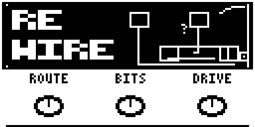

# Rewire

## Overview

Five lo-fi blocks (crush, drive, ring mod, comb, frequency shift) in a chain you can reorder.

## Controls

| Control | Default | Function |
| --- | ---: | --- |
| Route | 10 | Block order, five permutations: BDRCS, SCRDB, DSBCR, RCSBD, SBRDC (B=Bits D=Drive R=Ring C=Comb S=Shift). On knob 1 deliberately -- it is the control this effect exists for, and knobs 1-2 use the verbatim-stock edit handlers. Range 0–100. |
| Bits | 55 | Word length and sample-rate decimation together, 12-bit down to 3-bit with the hold rising alongside. Range 0–100. |
| Drive | 35 | Asymmetric soft clip, gain-compensated so turning it up does not just get louder. Range 0–100. |
| Ring | 20 | Ring modulator carrier, 30 Hz to ~2.2 kHz. Depth fades in from silence at 0 so the block is genuinely absent when down -- but it no longer DEFAULTS to absent, because with both Ring and Shift inert only three blocks were in the chain and Route had almost nothing left to permute. Range 0–100. |
| Comb | 25 | Short feedback comb, depth and length together. The only feedback path here, clamped below unity so no routing can make it run away. Range 0–100. |
| Shift | 50 | Single-sideband frequency shifter, centre-off. Range 0–100. |
| Tone | 55 | Low-pass on the wet path. Range 0–100. |
| Mix | 50 | Dry/wet crossfade. Range 0–100. |

## Usage

Play a repeated phrase and compare the processing order and routing display.

### Quick tutorial

1. Add Rewire from the Delay group to a spare patch.
2. Play a repeated phrase and compare the processing order and routing display.
3. Use the page buttons to reach the remaining controls.

## Compatibility and limitations

Hardware untested on the original MS-70CDR with OS 2.10. This build has startup knob initialization disabled. Check saved settings after recalling a patch.

## Tests and measurements

Ziddle passed the loader check and rendered 22,050 stereo frames. The compiled file passed the stock-code scan and MS-70CDR size limits. Hardware untested. [Verification](TESTING.md)

## Authorship and licences

Roman Rusinov and the ZoomMultistompZDL contributors. [Source](https://github.com/themanro/ZoomMultistompZDL/tree/aee98c53d7b568cbb55bb927aefbdc9b4e739f3e/src/custom/rewire) · [Licences](LICENSE)

## Screens and audio

