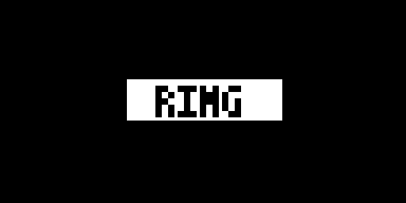

# Ring

## Overview

A spinning ring that follows your signal, full screen. Passes the sound through.

## Controls

| Control | Default | Function |
| --- | ---: | --- |
| Time | 25 | How much signal goes around the ring: 1-64 samples per point. Range 0–100. |
| Size | 35 | How far the signal pushes the ring in and out. Range 0–100. |
| Spin | 60 | 50 = still; below spins one way, above the other. Range 0–100. |

## Usage

Watch the rotating trace respond to quiet and loud input while the audio passes through.

### Quick tutorial

1. Add Ring from the Delay group to a spare patch.
2. Watch the rotating trace respond to quiet and loud input while the audio passes through.
3. Compare the effect with bypass using the footswitch.

## Compatibility and limitations

Hardware untested on the original MS-70CDR with OS 2.10. This build has startup knob initialization disabled. Check saved settings after recalling a patch.

## Tests and measurements

Ziddle passed the loader check and rendered 22,050 stereo frames. The compiled file passed the stock-code scan and MS-70CDR size limits. Hardware untested. [Verification](TESTING.md)

## Authorship and licences

Roman Rusinov and the ZoomMultistompZDL contributors. [Source](https://github.com/themanro/ZoomMultistompZDL/tree/aee98c53d7b568cbb55bb927aefbdc9b4e739f3e/src/custom/ring) · [Licences](LICENSE)

## Screens and audio

