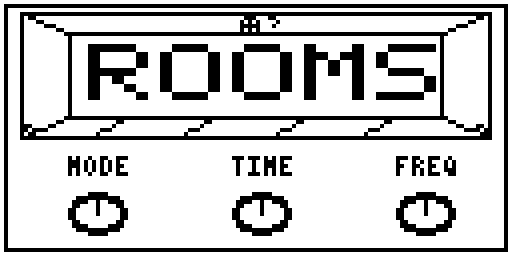

# Rooms

## Overview

A multi-mode reverb after the DBA Rooms: Room, Digit, Peak, Gate, Wave and Gong, with Freq and Depth reused per mode.

## Controls

| Control | Default | Function |
| --- | ---: | --- |
| Mode | 0 | params[5]. Reverb character: 0-16 ROOM, 17-33 DIGIT, 34-50 PEAK, 51-66 GATE, 67-83 WAVE, 84-100 GONG. Range 0–100. |
| Time | 55 | params[6]. Reverb decay length (all modes). Range 0–100. |
| Freq | 45 | params[7]. Per-mode frequency parameter (damping / crush-rate / filter freq / gate-time / LFO rate / gong pitch). Range 0–100. |
| Depth | 45 | params[8]. Per-mode depth parameter (size / bit-depth / resonance / threshold / mod depth / regen). Range 0–100. |
| Mix | 50 | params[9]. Dry/wet. Default 40 so it's audible on load (custom effects read params as 0 until a knob is touched, so this default is the on-load value). Push it up; high mix + high Time/Depth lets PEAK/GONG self-oscillate. Range 0–100. |

## Usage

Play a single hit and compare the room settings and tail length.

### Quick tutorial

1. Add Rooms from the Delay group to a spare patch.
2. Play a single hit and compare the room settings and tail length.
3. Use the page buttons to reach the remaining controls.

## Compatibility and limitations

Hardware untested on the original MS-70CDR with OS 2.10. This build has startup knob initialization disabled. Check saved settings after recalling a patch.

## Tests and measurements

Ziddle passed the loader check and rendered 22,050 stereo frames. The compiled file passed the stock-code scan and MS-70CDR size limits. Hardware untested. [Verification](TESTING.md)

## Authorship and licences

Roman Rusinov and the ZoomMultistompZDL contributors. [Source](https://github.com/themanro/ZoomMultistompZDL/tree/aee98c53d7b568cbb55bb927aefbdc9b4e739f3e/src/custom/rooms) · [Licences](LICENSE)

## Screens and audio

