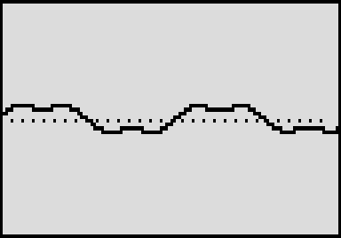

# Scope

A live oscilloscope of your signal on the pedal screen: the waveform, or left against right. By Roman Rusinov (Manro); version 0.3.0 lists his Scope 0.03, built with no code from Zoom's effects.

## Overview

Scope draws the signal coming into its slot across the whole screen, up to about 30 times a second, and passes the audio through untouched. Time spreads the trace from 3 to 186 ms across the screen, Gain zooms in up to 32 times, and Mode switches between the waveform and an XY view of left against right.

## Controls

| Knob | Default | What it does |
| --- | --- | --- |
| Time | 30 | Time across the screen: 1 to 64 samples per column (2.9 to 186 ms). |
| Gain | 25 | Vertical zoom, x0.5 to x32. |
| Mode | Wave | 0 = waveform, 1 = XY (left against right). |

## Usage

Add Scope to a patch from the effect list (Delay group). Add it to your set in the library and sync the set from the pedal page over USB, or install the file with Zoom Effect Manager; then power-cycle the pedal.

### Quick tutorial

1. Put Scope in a patch right after the effect you want to see.
2. Play: your signal draws across the screen. Time spreads it out, Gain zooms in.
3. Set Mode to 1 to see left against right (XY).

## Compatibility and limitations

- Its live screen needs the MS-70CDR 2.10.
- Built with the init path off: a recalled patch plays the knobs' defaults until you touch a knob.
- DSP 8 of the patch's 225 (300 with MIDISTOMP 2), as the effect declares it.

## Tests and measurements

See [TESTING.md](TESTING.md): the file has no code from Zoom's effects, passes Ziddle's loader check and renders in Ziddle. It has not run on a pedal yet.

## Authorship and licences

Scope is by Roman Rusinov (Manro), in ZoomMultistompZDL (MIT, Roman Rusinov and Jannik Aßfalg). The file is built with Leemuzhko's effect runtime (MIT), whose three call helpers are TI's RTS source (BSD-3-Clause). Every licence is in [LICENSE](LICENSE). Source: [src/custom/scope at 32f3d68](https://github.com/repeat98/ZoomMultistompZDL/tree/32f3d6877d892409c6defeeeec57040ad004d31f/src/custom/scope).

## Screens and audio

Rendered from the effect's own screen code by ZoomMultistompZDL's zvis_host.py at 32f3d68, not a photo of the pedal.
