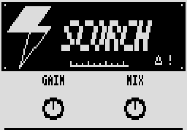

# Scorch

An aggressive high-gain amp with its cab built in: one Gain knob from crunch to a wall of distortion. By Roman Rusinov (Manro); version 2.0.0 lists his Scorch 2.00, built with no code from Zoom's effects.

## Overview

Scorch is a high-gain amp and cab in one effect: a tight high-pass before cascaded asymmetric clipping stages with filtering between them, a scooped tone stack, and a 4x12-style cab baked in as filters. Gain sets the distortion, and Mix blends it with your dry signal.

## Controls

| Knob | Default | What it does |
| --- | --- | --- |
| Gain | 22 | Preamp gain: the amount of distortion. |
| Mix | 50 | Dry and wet blend. |

## Usage

Add Scorch to a patch from the effect list (Delay group). Add it to your set in the library and sync the set from the pedal page over USB, or install the file with Zoom Effect Manager; then power-cycle the pedal.

### Quick tutorial

1. Put Scorch in a patch and turn Mix up to 100.
2. Raise Gain from crunch to full high gain.
3. Lower Mix to blend your dry signal back in.

## Compatibility and limitations

- Built with the init path off: a recalled patch plays the knobs' defaults until you touch a knob.
- DSP 20 of the patch's 225 (300 with MIDISTOMP 2), as the effect declares it.

## Tests and measurements

See [TESTING.md](TESTING.md): the file has no code from Zoom's effects, passes Ziddle's loader check and renders in Ziddle. It has not run on a pedal yet.

## Authorship and licences

Scorch is by Roman Rusinov (Manro), in ZoomMultistompZDL (MIT, Roman Rusinov and Jannik Aßfalg). The file is built with Leemuzhko's effect runtime (MIT), whose three call helpers are TI's RTS source (BSD-3-Clause). Every licence is in [LICENSE](LICENSE). Source: [src/custom/scorch at 32f3d68](https://github.com/repeat98/ZoomMultistompZDL/tree/32f3d6877d892409c6defeeeec57040ad004d31f/src/custom/scorch).

## Screens and audio

The cover picture inside the release file itself, decoded from its Zoom RLE: what the pedal shows for this effect.
