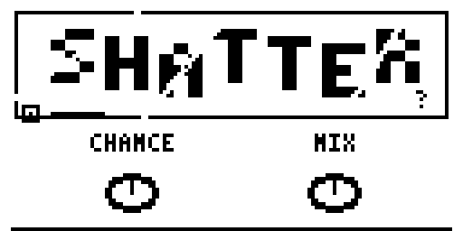

# Shatter

## Overview

A stutter and beat-repeat glitch for drums.

## Controls

| Control | Default | Function |
| --- | ---: | --- |
| Chnce | 55 | params[5]. Probability each slice glitches (stutter/reverse). Range 0–100. |
| Mix | 50 | Mix default 1 (quiet-safe). The editor materialises patches on load (full-patch send), so audible-on-load no longer needs a hot default. Range 0–100. |

## Usage

Use sharp drum hits and listen for stutters and pitch changes.

### Quick tutorial

1. Add Shatter from the Delay group to a spare patch.
2. Use sharp drum hits and listen for stutters and pitch changes.
3. Compare the effect with bypass using the footswitch.

## Compatibility and limitations

Hardware untested on the original MS-70CDR with OS 2.10. This build has startup knob initialization disabled. Check saved settings after recalling a patch.

## Tests and measurements

Ziddle passed the loader check and rendered 22,050 stereo frames. The compiled file passed the stock-code scan and MS-70CDR size limits. Hardware untested. [Verification](TESTING.md)

## Authorship and licences

Roman Rusinov and the ZoomMultistompZDL contributors. [Source](https://github.com/themanro/ZoomMultistompZDL/tree/aee98c53d7b568cbb55bb927aefbdc9b4e739f3e/src/custom/shatter) · [Licences](LICENSE)

## Screens and audio

