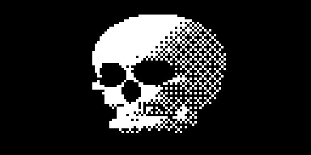

# Skull

## Overview

A shaded 3D skull that reacts to your playing: the jaw opens, the eyes light, it jolts on attacks and explodes at the loudest. Passes the sound through.

## Controls

| Control | Default | Function |
| --- | ---: | --- |
| Sense | 50 | How much signal it takes to open the jaw. Range 0–100. |
| Decay | 40 | How fast the face relaxes after a note. Range 0–100. |
| Shake | 50 | How hard the skull jolts on attacks (0 = never). Range 0–100. |
| Boom | 50 | At the very loudest the skull explodes and re-forms. 0 = never; higher = easier to set off. Range 0–100. |

## Usage

Compare quiet notes and loud attacks. Watch the jaw, shake and burst while the audio passes through.

### Quick tutorial

1. Add Skull from the Delay group to a spare patch.
2. Compare quiet notes and loud attacks. Watch the jaw, shake and burst while the audio passes through.
3. Use the page buttons to reach the remaining controls.

## Compatibility and limitations

Hardware untested on the original MS-70CDR with OS 2.10. This build has startup knob initialization disabled. Check saved settings after recalling a patch.

## Tests and measurements

Ziddle passed the loader check and rendered 22,050 stereo frames. The compiled file passed the stock-code scan and MS-70CDR size limits. Hardware untested. [Verification](TESTING.md)

## Authorship and licences

Roman Rusinov and the ZoomMultistompZDL contributors. [Source](https://github.com/themanro/ZoomMultistompZDL/tree/aee98c53d7b568cbb55bb927aefbdc9b4e739f3e/src/custom/skull) · [Licences](LICENSE)

## Screens and audio

