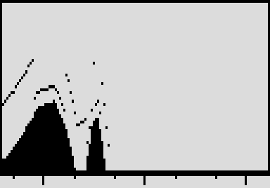

# Spectrum

A live spectrum analyzer on the pedal screen, 40 Hz to 16 kHz, with peak hold. By Roman Rusinov (Manro); version 0.2.0 lists his Spectrum 0.02, built with no code from Zoom's effects.

## Overview

Spectrum shows what reaches its slot as 126 log-spaced bars from 40 Hz to 16 kHz with peak hold, up to about 30 times a second, and passes the audio through untouched. Range sets how far below full scale it shows, Fall how fast the bars drop, and Tilt lifts the highs so pink noise reads flat.

## Controls

| Knob | Default | What it does |
| --- | --- | --- |
| Range | 50 | Shown range below 0 dBFS: 30 to 90 dB. |
| Fall | 40 | How fast the bars fall. |
| Tilt | 50 | Lifts the highs: 0 to 6 dB per octave around 1 kHz, so pink noise reads flat at the default. |

## Usage

Add Spectrum to a patch from the effect list (Delay group). Add it to your set in the library and sync the set from the pedal page over USB, or install the file with Zoom Effect Manager; then power-cycle the pedal.

### Quick tutorial

1. Put Spectrum last in a patch to see what the chain sends out.
2. Play: the bars show 40 Hz to 16 kHz, with the peaks held above them.
3. Range sets how far below full scale it shows, Fall how fast the bars drop, Tilt lifts the highs.

## Compatibility and limitations

- Its live screen needs the MS-70CDR 2.10.
- Built with the init path off: a recalled patch plays the knobs' defaults until you touch a knob.
- DSP 8 of the patch's 225 (300 with MIDISTOMP 2), as the effect declares it.

## Tests and measurements

See [TESTING.md](TESTING.md): the file has no code from Zoom's effects, passes Ziddle's loader check and renders in Ziddle. It has not run on a pedal yet.

## Authorship and licences

Spectrum is by Roman Rusinov (Manro), in ZoomMultistompZDL (MIT, Roman Rusinov and Jannik Aßfalg). The file is built with Leemuzhko's effect runtime (MIT), whose three call helpers are TI's RTS source (BSD-3-Clause). Every licence is in [LICENSE](LICENSE). Source: [src/custom/spectrum at 32f3d68](https://github.com/repeat98/ZoomMultistompZDL/tree/32f3d6877d892409c6defeeeec57040ad004d31f/src/custom/spectrum).

## Screens and audio

Rendered from the effect's own screen code by ZoomMultistompZDL's zvis_host.py at 32f3d68, not a photo of the pedal.
