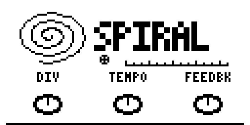

# Spiral

## Overview

A tempo-locked delay whose repeats climb or sink in pitch, compounding with every repeat; Glide adds a rise that starts at each note.

## Controls

| Control | Default | Function |
| --- | ---: | --- |
| Div | 30 | Musical division of the tempo below: 1/32, 1/16T, 1/16, 1/8T, 1/8, dotted 1/8, 1/4, dotted 1/4. Default 30 lands on 1/16, which at 120 BPM is the 125 ms that the old Time=17 produced. Range 0–100. |
| Tempo | 120 | BPM, read straight off the knob so the pedal's own number IS the tempo. Clamped to 40..240 in the DSP. Range 0–240. |
| Feed | 60 | Repeats, scaled to 0.965 and soft-clipped in the loop. Range 0–100. |
| Rise | 62 | Per-repeat ratio: 0 = octave down, 50 = unity, 100 = octave up. Range 0–100. |
| Glide | 45 | Depth of the onset-triggered ramp on that ratio. Range 0–100. |
| Span | 45 | How long the rise takes, ~0.19 s .. ~8 s. Range 0–100. |
| Tone | 50 | Low-pass inside the feedback loop. Range 0–100. |
| Mix | 50 | Dry/wet. Range 0–100. |

## Usage

Play isolated notes and listen for the repeats to climb or fall as Rise moves through centre.

### Quick tutorial

1. Add Spiral from the Delay group to a spare patch.
2. Play isolated notes and listen for the repeats to climb or fall as Rise moves through centre.
3. Use the page buttons to reach the remaining controls.

## Compatibility and limitations

Hardware untested on the original MS-70CDR with OS 2.10. This build has startup knob initialization disabled. Check saved settings after recalling a patch.

## Tests and measurements

Ziddle passed the loader check and rendered 22,050 stereo frames. The compiled file passed the stock-code scan and MS-70CDR size limits. Hardware untested. [Verification](TESTING.md)

## Authorship and licences

Roman Rusinov and the ZoomMultistompZDL contributors. [Source](https://github.com/themanro/ZoomMultistompZDL/tree/aee98c53d7b568cbb55bb927aefbdc9b4e739f3e/src/custom/spiral) · [Licences](LICENSE)

## Screens and audio

