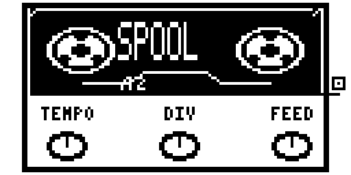

# Spool

## Overview

A tempo-locked tape echo with flutter, wow, head wear, drive and a spring tail. Feed self-oscillates above about 90.

## Controls

| Control | Default | Function |
| --- | ---: | --- |
| Tempo | 120 | BPM source for synced delay times. Descriptor is marked with the stock tempo flag pattern; true tap-tempo host writes still need hardware proof. Range 0–240. |
| Div | 67 | Discrete musical division selector inside the DSP: 1/16, 1/8T, 1/8, dotted 1/8, 1/4, dotted 1/4. Range 0–100. |
| Feed | 35 | Progressive repeats through 80; loop coefficient crosses unity near 92, reaching 1.4 at 100. Actual sustain depends on Wear, Drive and signal spectrum; record saturation bounds the loop. Range 0–100. |
| Flutr | 35 | Fast tape flutter depth. Range 0–100. |
| Wow | 25 | Slow tape-speed drift depth. Range 0–100. |
| Wear | 55 | Adds aged-tape filtering around the fixed Galaxy-derived head/tape FIR response. Range 0–100. |
| Drive | 35 | TapeHack-style soft clipping into the record path. Range 0–100. |
| Sprng | 0 | Experimental parallel mono spring-reverb return. Disabled by default while a closer Galaxy model is developed. Range 0–100. |
| Mix | 35 | Dry/wet crossfade. Range 0–100. |

## Usage

Play clipped notes and listen for repeated attacks, tape wear and wow as you raise feedback.

### Quick tutorial

1. Add Spool from the Delay group to a spare patch.
2. Play clipped notes and listen for repeated attacks, tape wear and wow as you raise feedback.
3. Use the page buttons to reach the remaining controls.

## Compatibility and limitations

Hardware untested on the original MS-70CDR with OS 2.10. This build has startup knob initialization disabled. Check saved settings after recalling a patch.

## Tests and measurements

Ziddle passed the loader check and rendered 22,050 stereo frames. The compiled file passed the stock-code scan and MS-70CDR size limits. Hardware untested. [Verification](TESTING.md)

## Authorship and licences

Roman Rusinov and the ZoomMultistompZDL contributors; Airwindows / Chris Johnson (source or inspiration). [Source](https://github.com/themanro/ZoomMultistompZDL/tree/aee98c53d7b568cbb55bb927aefbdc9b4e739f3e/src/airwindows/tapeecho4) · [Licences](LICENSE)

## Screens and audio

