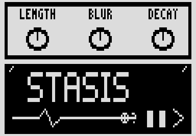

# Stasis

A footswitch freeze: turn it on and the note you just played holds while you play over it. By Roman Rusinov (Manro); version 1.2.0 lists his Stasis 1.02, built with no code from Zoom's effects.

## Overview

Stasis keeps listening while it is off. Turn it on with the footswitch and it holds the last moments you played as a seamless loop, while your dry signal stays open on top; turn it off to let go. Length, Blur, Decay and Tone shape the hold, and Capture can hold or release independently of the footswitch.

## Controls

| Knob | Default | What it does |
| --- | --- | --- |
| Length | 35 | Loop length, about 60 ms to 1.4 s, live. |
| Blur | 50 | Crossfade at the loop seam, as a share of the loop. |
| Decay | 100 | How the hold fades; fully up holds for ever. |
| Tone | 55 | Low-pass on the held layer only; the dry stays open. |
| Mix | 50 | Dry and wet blend while it holds; idle passes dry at unity. |
| Capture | Stomp | 0 = the footswitch captures and releases; 1 = release; 2 = capture and hold regardless of the footswitch. |

## Usage

Add Stasis to a patch from the effect list (Delay group). Add it to your set in the library and sync the set from the pedal page over USB, or install the file with Zoom Effect Manager; then power-cycle the pedal.

### Quick tutorial

1. Put Stasis in a patch, leave Capture at 0 and play a note.
2. Turn Stasis on with the footswitch: what you just played holds while you play over it.
3. Turn it off to let go. Length, Blur, Decay and Tone shape the hold.

## Compatibility and limitations

- A patch loads with nothing held: it never freezes on load.
- Built with the init path off: a recalled patch plays the knobs' defaults until you touch a knob.
- DSP 20 of the patch's 225 (300 with MIDISTOMP 2), as the effect declares it.

## Tests and measurements

See [TESTING.md](TESTING.md): the file has no code from Zoom's effects, passes Ziddle's loader check and renders in Ziddle. It has not run on a pedal yet.

## Authorship and licences

Stasis is by Roman Rusinov (Manro), in ZoomMultistompZDL (MIT, Roman Rusinov and Jannik Aßfalg). The file is built with Leemuzhko's effect runtime (MIT), whose three call helpers are TI's RTS source (BSD-3-Clause). Every licence is in [LICENSE](LICENSE). Source: [src/custom/stasis at 32f3d68](https://github.com/repeat98/ZoomMultistompZDL/tree/32f3d6877d892409c6defeeeec57040ad004d31f/src/custom/stasis).

## Screens and audio

The cover picture inside the release file itself, decoded from its Zoom RLE: what the pedal shows for this effect.
