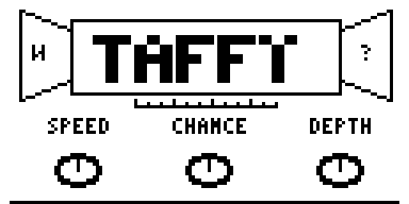

# Taffy

## Overview

A tape warp after the Red Panda Tensor: reverse, stop, double speed and random slips.

## Controls

| Control | Default | Function |
| --- | ---: | --- |
| Speed | 50 | params[5]. Tape-motor speed the head ALWAYS trends toward: 0=-1x reverse, 25=stop, 50=+1x normal, 100=+2x octave up. Range 0–100. |
| Chnce | 35 | params[6]. How often random speed/direction slips happen. Range 0–100. |
| Depth | 60 | params[7]. How far a slip deviates from Speed (0 = slips do nothing, pure speed control; 100 = fully random tape warps). Range 0–100. |
| Glide | 60 | params[8]. Tape-motor smoothness: 0 = snappy/abrupt speed jumps, 100 = long smooth pitch glides. Range 0–100. |
| Mix | 50 | Mix default 1 (quiet-safe). The editor materialises patches on load (full-patch send), so audible-on-load no longer needs a hot default. Range 0–100. |

## Usage

Play a recognisable phrase and listen for changes in playback speed.

### Quick tutorial

1. Add Taffy from the Delay group to a spare patch.
2. Play a recognisable phrase and listen for changes in playback speed.
3. Use the page buttons to reach the remaining controls.

## Compatibility and limitations

Hardware untested on the original MS-70CDR with OS 2.10. This build has startup knob initialization disabled. Check saved settings after recalling a patch.

## Tests and measurements

Ziddle passed the loader check and rendered 22,050 stereo frames. The compiled file passed the stock-code scan and MS-70CDR size limits. Hardware untested. [Verification](TESTING.md)

## Authorship and licences

Roman Rusinov and the ZoomMultistompZDL contributors. [Source](https://github.com/themanro/ZoomMultistompZDL/tree/aee98c53d7b568cbb55bb927aefbdc9b4e739f3e/src/custom/taffy) · [Licences](LICENSE)

## Screens and audio

