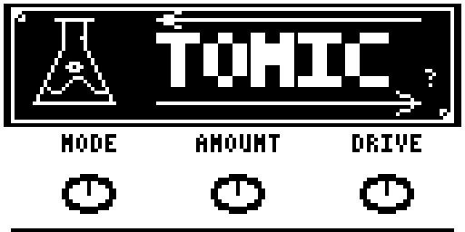

# Tonic

## Overview

A Bitters-inspired multi-effect: drive, a phaser and one of decimate, crush, FM or ring mod, in either order.

## Controls

| Control | Default | Function |
| --- | ---: | --- |
| Mode | 12 | Four named regions: Decim, Crush, FM, Ring. Range 0–100. |
| Amnt | 25 | Selected processor strength; zero bypasses it. Range 0–100. |
| Drive | 0 | Gain-compensated cubic distortion; zero bypasses it. Range 0–100. |
| Phase | 0 | Six-stage sine-swept phaser, up to 20 Hz; zero bypasses it. Range 0–100. |
| Order | 0 | Fwd: Drive-Phase-Mode. Rev: Mode-Phase-Drive. Range 0–100. |
| Mix | 50 | Stereo dry to mono processed wet; exact dry at zero. Range 0–100. |

## Usage

Try each processor on the same phrase, then reverse the processing order.

### Quick tutorial

1. Add Tonic from the Delay group to a spare patch.
2. Try each processor on the same phrase, then reverse the processing order.
3. Use the page buttons to reach the remaining controls.

## Compatibility and limitations

Hardware untested on the original MS-70CDR with OS 2.10. This build has startup knob initialization disabled. Check saved settings after recalling a patch.

## Tests and measurements

Ziddle passed the loader check and rendered 22,050 stereo frames. The compiled file passed the stock-code scan and MS-70CDR size limits. Hardware untested. [Verification](TESTING.md)

## Authorship and licences

Roman Rusinov and the ZoomMultistompZDL contributors. [Source](https://github.com/themanro/ZoomMultistompZDL/tree/aee98c53d7b568cbb55bb927aefbdc9b4e739f3e/src/custom/tonic) · [Licences](LICENSE)

## Screens and audio

